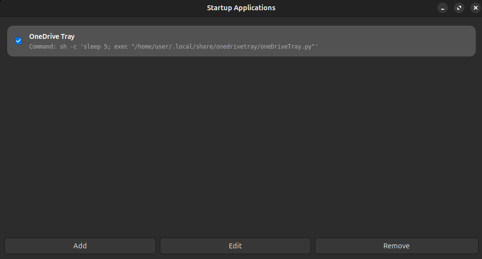

# Autostart Manager

A lightweight, modern GTK3 desktop utility designed to manage user startup applications and scripts effortlessly across Linux desktop environments.



## Overview

Many modern Linux distributions no longer ship with a simple, dedicated tool for managing user autostart entries (`.desktop` files in `~/.config/autostart`). 

Inspired by classic desktop utilities (such as the traditional GNOME Startup Applications tool), **Autostart Manager** fills this gap by offering a clean, modern interface to easily view, toggle, edit, and create startup items without needing to manage `.desktop` files manually in the terminal.

## Features

* **Clean & Modern UI:** Built with GTK3, featuring smooth card layouts, responsive design, and dark mode support.
* **Localization Support:** Full support for English (EN) and Portuguese (PT / PT-PT).
* **Toggle & Edit Entries:** Easily enable, disable, edit, or remove startup items.
* **File Browser Integration:** Integrated file chooser to quickly select scripts or executable binaries.
* **Standard Compliant:** Native support for standard Freedesktop `.desktop` files in `~/.config/autostart`.

## Installation (.deb)

Download the latest `.deb` package from the [Releases](../../releases) page and install it using your package manager or terminal:

```bash
sudo apt install ./autostart-manager_1.0-2_all.deb
```

## Running from Source

Make sure you have Python 3 and GTK3 dependencies installed:

```bash
sudo apt install python3 python3-gi gir1.2-gtk-3.0
```

Then run:

```bash
./main.py
```

## License

Distributed under the MIT License. See `LICENSE` for details.